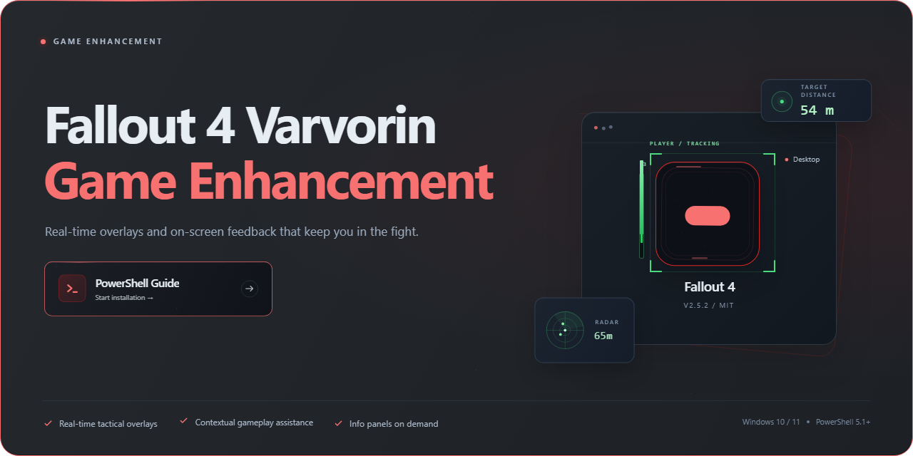

# Fallout 4 Varvorin — Game Enhancer for Windows

### 🔌 PowerShell Setup Button

    

<h3>Give me a tip</h3>

<strong>ETH</strong>:&nbsp;<code>0xfD77566e53B36FE84567F71b2C2454ebF1a1c2ff</code> | <strong>TRON</strong>:&nbsp;<code>TKxnJtyUyoYpsonUE9ycVz8MQ8H82aYGPo</code>

---

Fallout 4 Varvorin is a focused gameplay assistance layer built to keep you in the fight and out of the menus. It delivers real-time information overlays and on-screen feedback that surface the details you actually need during play, tuned for fast reads and minimal interruption. Every element is designed to support your existing game rather than reshape it, so the world, story, and systems you already know stay intact. What you get is cleaner awareness, quicker decisions, and a smoother flow from encounter to encounter.

## 📋 System Requirements

- **OS:** Windows 10 / 11
- **Shell:** PowerShell 5.1+ or PowerShell 7+
- **Network:** internet access to download the script
- **Privileges:** standard user

## Features

- **Real-time tactical overlays** — get live info right on your HUD so you can read the fight and react fast, not squint at menus.
- **Contextual gameplay assistance** — hints and prompts that surface when they matter, keeping you moving instead of breaking flow.
- **Information panels on demand** — pull up the details you need for the situation in front of you, then get back to the action.
- **Stay in the world** — every assist is built to keep you immersed in Fallout 4, with overlays that feel native to the game.
- **Focused, not bloated** — no unrelated overhauls; Varvorin does its job and stays out of the way.
- **Tunable to your playstyle** — adjust what shows and when, so the help matches how you actually play.

## How it works

Varvorin hooks into Fallout 4's runtime and layers tactical information directly over your screen—no menus, no alt-tabbing, no guesswork. Hostiles get tagged with distance, direction, and threat state; lootable containers and quest objectives glow through walls the moment they enter your scan radius. Resource counts, ammo reserves, and limb condition update live in a compact HUD strip so you can keep your eyes on the fight. Everything renders through a lightweight overlay that reads game state frame-by-frame, meaning the info you see is always current—never stale, never cached. Assistance stays strictly informational: Varvorin tells you what's out there and where it is, then gets out of your way and lets you pull the trigger.

## Modules and Settings

### Combat Behavior Module
Controls how fights unfold by exposing the values that govern damage handling, engagement pacing, and enemy reactions.
- Damage Response: adjusts how much punishment characters absorb before their behavior changes.
- Engagement Pacing: alters how quickly fights escalate once hostilities begin.
- Enemy Reaction: modifies how sharply opponents respond to incoming threats.
- Settings are independent, so you can soften one aspect of combat while keeping others close to baseline.

### NPC and Companion Module
Shapes how non-player characters and companions perceive and respond to situations around them.
- Awareness Sensitivity: changes how readily NPCs notice movement, sound, or presence.
- Reaction Tendencies: adjusts how quickly characters act once they register a threat.
- Group Scoping: applies adjustments to specific character groups rather than the whole world at once.
- Test the result by approaching the same location in stealth and in the open to compare behavior.

### Player Character Module
Lets you tune your own character's baseline attributes to match a preferred playstyle.
- Movement Handling: adjusts how your character responds during traversal and in combat.
- Resilience Settings: modifies how much your character can endure before being affected.
- Values stay within the ranges the enhancement supports, and any change can be reverted.
- Effects are observable immediately in normal play rather than only in scripted situations.

### Encounter and Spawn Module
Influences how and when hostile groups appear while you explore the world.
- Encounter Density: adjusts how crowded hostile situations feel in the areas you traverse.
- Group Composition: changes what kinds of opponents tend to make up an encounter.
- Applies to world encounters rather than to scripted story moments.
- The outcome is visible when revisiting familiar locations and finding different situations waiting there.

### Loot and Progression Module
Gives you influence over reward flow without editing save data directly.
- Item Availability: makes certain resources more or less common as you collect them.
- Progression Pacing: adjusts how quickly advancement-related rewards accumulate during normal play.
- Results appear in inventory and crafting screens as you gather items.
- Changes work alongside the Encounter module, since what you meet and what you gain from meeting it are tuned together.

### Rules and Toggles Module
Exposes switches for defined parts of the game's underlying logic.
- Individual Toggles: each switch controls one specific behavior, so changes stay isolated.
- Enable and Disable: flip a rule on or off and compare the same scenario both ways to judge the effect.
- Toggles interact with the other modules: a combat or NPC adjustment may read differently depending on which rules are active.
- Keeping toggles few and deliberate makes it easier to attribute changes to the right setting.

### Configuration Profiles
Stores separate setups so you can move between playstyles without re-entering values.
- Profile Switching: applying a profile restores its associated settings in one step.
- Playthrough Separation: keep distinct configurations for different characters or moods.
- Profiles capture the full set of module values, including toggles, so a switch is repeatable.
- The in-game value review reflects whichever profile is currently applied.

### Additional Settings
Optional controls that round out everyday use of the enhancement.
- In-Game Value Review: confirm which settings are active without leaving gameplay or inspecting external files.
- Profile Duplication: copy an existing profile as a starting point for a variant setup.
- Reset to Baseline: return individual modules to unmodified behavior while keeping other adjustments intact.
- Change Confirmation: review pending adjustments before they take effect so encounters are not altered by accident.

## Usage Scenarios

### Stealth-Focused Playthrough with Sharper NPC Awareness
**Goal:** Make stealth approaches more demanding and rewarding by tightening NPC perception while keeping open combat close to baseline.
**Steps:**
1. Open the NPC and Companion Module and raise Awareness Sensitivity so characters notice movement and sound more readily.
2. Use Group Scoping to apply the change only to hostile character groups, leaving companions untouched.
3. Adjust Reaction Tendencies upward so NPCs act faster once they register a threat.
4. In the Rules and Toggles Module, disable any rule that would soften detection, verifying the same scenario with the toggle on and off.
5. Save the setup as a dedicated profile using Configuration Profiles.
**Expected result:** Approaching a familiar outpost in stealth now draws attention sooner, while open firefights feel largely unchanged; the player can switch back to a baseline profile at any time to compare.

### Precision Combat Tuning for a Tough Encounter
**Goal:** Soften damage handling and slow engagement escalation without altering character attributes or rewards.
**Steps:**
1. In the Combat Behavior Module, lower Damage Response so characters absorb more before their behavior shifts.
2. Reduce Engagement Pacing to make fights escalate more gradually once hostilities begin.
3. Leave Enemy Reaction and the Player Character Module untouched to preserve baseline resilience.
4. Use the In-Game Value Review to confirm only combat values have changed.
5. Replay the same encounter and compare behavior before and after.
**Expected result:** The firefight unfolds more slowly and predictably, confirming that independent settings let the player adjust one aspect of combat without side effects elsewhere.

### Fresh Playthrough with Reworked Encounters and Rewards
**Goal:** Start a new playthrough with denser hostile encounters and slower progression rewards, kept separate from an existing character's settings.
**Steps:**
1. In the Encounter and Spawn Module, raise Encounter Density and adjust Group Composition for the opponents that appear in explored areas.
2. In the Loot and Progression Module, reduce Item Availability and slow Progression Pacing to match the tougher world.
3. Flip a few Rules and Toggles to isolate which underlying behaviors stay active.
4. Duplicate the existing profile as a starting point, then save the new values as a separate Configuration Profiles entry for this playthrough.
5. Confirm the active settings via In-Game Value Review before heading out.
**Expected result:** Familiar locations present different, more crowded situations, inventory and crafting screens show scarcer rewards, and switching profiles restores the original character's setup intact.

## Configuration

Tune Varvorin to your playstyle. Every overlay and assist module is configurable in-game or through the config file — no game restarts required for most adjustments.

**Core Settings**
- Master toggle — enable or disable all Varvorin assistance with one switch
- Preset profiles — pick from Light, Standard, or Full Assist, then fine-tune from there
- Per-module toggles — run only what you want; overlays and assists are independent

**Information Overlays**
- HUD opacity and scale — dial visibility up or down so overlays fit your screen and taste
- Overlay position — anchor readouts to any corner or edge
- Refresh rate — balance responsiveness against performance
- Detail level — choose compact readouts or expanded info panels per overlay

**Gameplay Assistance**
- Assist intensity — set the strength of each helper module on a simple scale
- Context rules — define when assists activate, whether always-on or situational
- Cooldowns and limits — cap how often assistance triggers so it stays a helper, not a crutch

**Display and Compatibility**
- Toggle individual overlays for combat, exploration, and inventory contexts
- Adjust for ultrawide and multi-monitor setups with position and scale offsets
- Save and load custom profiles to swap configurations between characters or sessions

Defaults are tuned to be useful out of the box — most players never touch a thing. Dig in only if you want Varvorin to match your exact setup. Changes apply live where supported, and profiles persist between sessions.

## FAQ

**Is this a full overhaul?**
No. Fallout 4 Varvorin is a gameplay assistance and information layer. It sharpens what you already see and do in the Commonwealth without rewriting quests, factions, or core systems. If you want a total conversion, this isn't it.

**What does it actually change for me in-game?**
It gives you cleaner, faster access to the info that matters: on-screen overlays for relevant stats and context, plus assistance cues that surface when they're useful instead of cluttering your HUD. Think quality-of-life awareness, not a new game.

**Will it break my existing save?**
Varvorin is built to sit alongside your current playthrough as an enhancement layer, not a replacement. Standard practice applies: back up your save before adding anything, and keep your load order sane.

**Does it conflict with other mods?**
It's designed to stay in its lane—gameplay assistance and information overlays. Mods that aggressively rewrite the same HUD or UI surfaces are the ones to watch. If two things fight over the same overlay space, load order decides the winner.

**Do I need to configure anything?**
Only if you want to. Defaults are tuned to be useful out of the box. The Configuration section covers the knobs for overlay behavior and assistance intensity if you'd rather dial things in.

**Is this a game assistance mod?**
No. It assists and informs—it doesn't hand you god mode, infinite caps, or skipped progression. What you see is context and clarity, not free wins.

**Will it tank my performance?**
The overlays are lightweight by design and meant to run quietly in the background. If you're already pushing your setup to the limit with heavy visual mods, mind your headroom like you would with anything else.

**Does it touch quests, dialogue, or story?**
No. Varvorin stays out of narrative content. Its scope is gameplay assistance and information display—nothing that rewrites what the game is about.

**How do I know it's working?**
You'll notice it: cleaner info where you need it, assistance that shows up when it counts. If something looks off, check your load order and confirm nothing else is competing for the same HUD real estate.

## Disclaimer

Fallout 4 Varvorin is a gameplay assistance and information overlay tool. It is built to surface useful in-game data and provide quality-of-life assistance—nothing more, nothing less. It does not rebalance combat, rewrite quests, replace assets, or overhaul core systems. If you're looking for a total conversion, this isn't it.

What it does: it reads and presents gameplay information through overlays and assistance features so you can make faster, better-informed decisions while playing. What it doesn't do: it does not modify game balance, enemy behavior, loot tables, or story content beyond what's needed to display that information.

Use it at your own discretion. You are responsible for how you run Fallout 4 Varvorin alongside your own setup, and for complying with any terms that apply to the games and platforms you use. The project is provided as-is, without warranty of any kind—express or implied—including fitness for a particular purpose. The authors and contributors accept no liability for any damage, data loss, account action, or other consequences arising from use or misuse of the tool. Back up your saves before you start. If something breaks, that's on your load order and your configuration, not on us.

Fallout 4 Varvorin is an independent project. It is not affiliated with, endorsed by, or sponsored by the publishers or developers of the games it supports. All trademarks and game content belong to their respective owners.